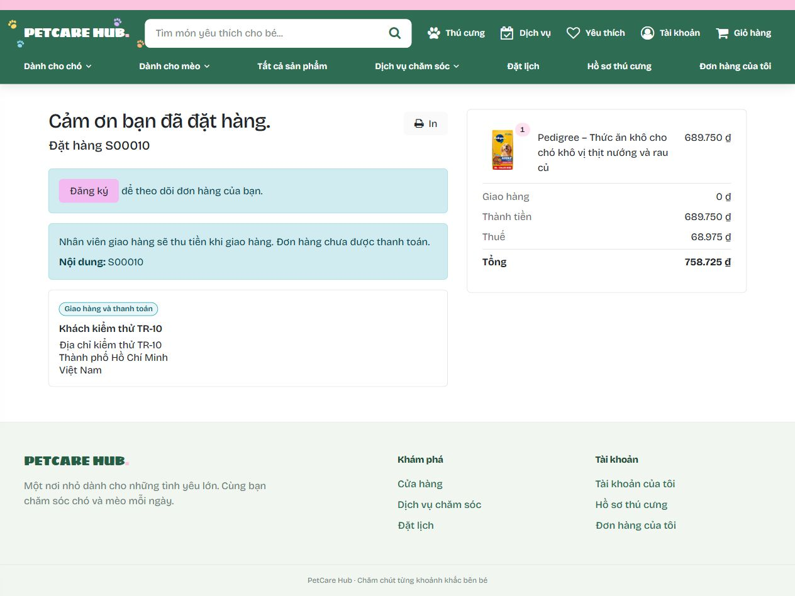

# Kết quả thực tế TR-10 — 28/11/2026

## Đã thực hiện

- Docker và Odoo cổng 8070 đã hoạt động sau khi người dùng khởi động lại Docker.
- Kiểm tra trực tiếp: `payment_stripe` đã cài; Stripe đang tắt, chưa có khóa test và secret webhook. COD đang bật.
- Thực hiện qua giao diện cửa hàng: thêm một sản phẩm Pedigree, kiểm tra giỏ, nhập khách và địa chỉ giả dành riêng cho TR-10, xác nhận giao hàng rồi chọn COD.
- Đơn **S00010**: 689.750 VND tiền hàng + 68.975 VND thuế + 0 VND giao hàng = **758.725 VND**. Đây là giá trị được Odoo tính trong cấu hình nhóm, chưa phải đánh giá đúng/sai chính sách thuế của doanh nghiệp.
- Đọc lại Odoo: đơn `sale`, giao dịch `pending` với nhà cung cấp COD, phiếu giao `assigned`. Không ghi nhận đã thu tiền hoặc hoàn thành giao hàng.
- Đã thêm mã tham chiếu khách hàng “TR-10 - ĐƠN KIỂM THỬ - KHÔNG GIAO HÀNG” và ghi chú trên phiếu giao.
- Cài mô-đun `petcare_payment_vi` để Việt hóa các phần còn tiếng Anh ở xác nhận đơn, địa chỉ và mua lại đơn; đã mở lại trang xác nhận và kiểm tra thông báo, địa chỉ, tổng tiền hiển thị đúng.
- Đã đổi thông báo COD tiếng Việt, ghi rõ “Đơn hàng chưa được thanh toán”. Trước khi cài đã sao lưu cơ sở dữ liệu vào tệp riêng ngoài GitHub. Bản sao này không gồm filestore.

## Ảnh kết quả

Ảnh chụp trực tiếp trang xác nhận sau khi Việt hóa, dùng dữ liệu khách giả:

## Chưa hoàn thành

Các ca Stripe thành công, thẻ bị từ chối, khách hủy và webhook chưa chạy vì chưa có cấu hình tài khoản test. Không dùng COD hoặc kiểm tra mã nguồn để thay thế minh chứng Stripe. Chưa cập nhật báo cáo chung hoặc bảng phân công thành “hoàn thành”.

## Nội dung có thể đưa vào báo cáo 5.3/5.5

Hệ thống sử dụng mô-đun thanh toán sẵn có của Odoo theo hướng BUY/CUSTOMIZE. Kiểm thử TC-01 ngày 28/11/2026 đã xác nhận khách có thể đặt đơn sản phẩm bằng COD với tổng tiền VND. Đơn S00010 chuyển sang trạng thái đơn bán, trong khi giao dịch COD vẫn chờ thu tiền. Các ca Stripe test và webhook đang chờ tài khoản thử nghiệm, do đó TR-10 mới hoàn tất một phần.
