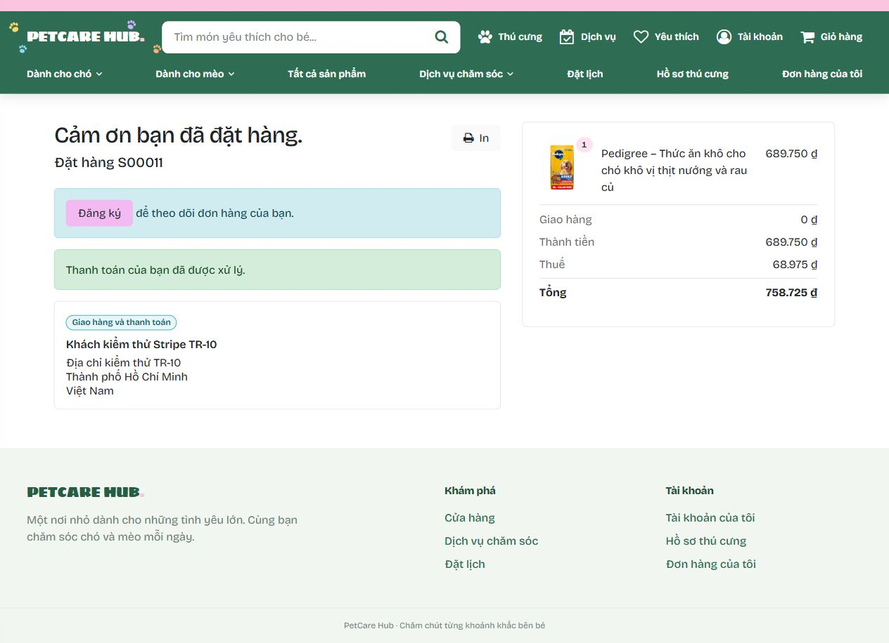
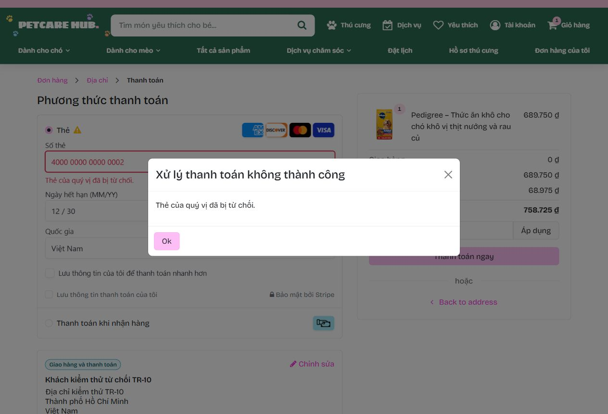
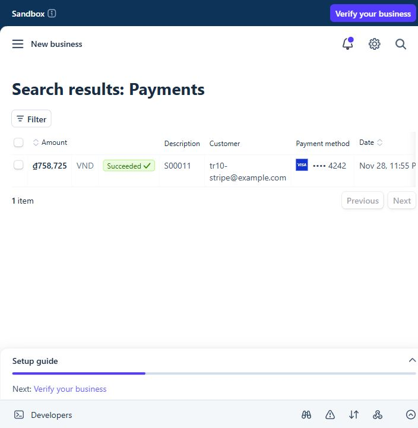
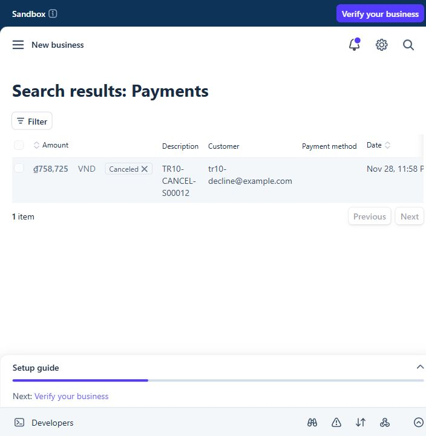

# Kết quả thực tế TR-10 — 28–29/11/2026

## Đã thực hiện

- Docker và Odoo cổng 8070 đã hoạt động sau khi người dùng khởi động lại Docker.
- Kiểm tra trực tiếp: `payment_stripe` đã cài; Stripe đang tắt, chưa có khóa test và secret webhook. COD đang bật.
- Thực hiện qua giao diện cửa hàng: thêm một sản phẩm Pedigree, kiểm tra giỏ, nhập khách và địa chỉ giả dành riêng cho TR-10, xác nhận giao hàng rồi chọn COD.
- Đơn **S00010**: 689.750 VND tiền hàng + 68.975 VND thuế + 0 VND giao hàng = **758.725 VND**. Đây là giá trị được Odoo tính trong cấu hình nhóm, chưa phải đánh giá đúng/sai chính sách thuế của doanh nghiệp.
- Đọc lại Odoo: đơn `sale`, giao dịch `pending` với nhà cung cấp COD, phiếu giao `assigned`. Không ghi nhận đã thu tiền hoặc hoàn thành giao hàng.
- Đã thêm mã tham chiếu khách hàng “TR-10 - ĐƠN KIỂM THỬ - KHÔNG GIAO HÀNG” và ghi chú trên phiếu giao.
- Cài mô-đun `petcare_payment_vi` để Việt hóa các phần còn tiếng Anh ở xác nhận đơn, địa chỉ và mua lại đơn; đã mở lại trang xác nhận và kiểm tra thông báo, địa chỉ, tổng tiền hiển thị đúng.
- Đã đổi thông báo COD tiếng Việt, ghi rõ “Đơn hàng chưa được thanh toán”. Trước khi cài đã sao lưu cơ sở dữ liệu vào tệp riêng ngoài GitHub. Bản sao này không gồm filestore.

## Ảnh kết quả

Ảnh chụp trực tiếp trang xác nhận sau khi Việt hóa, dùng dữ liệu khách giả:

## Stripe test và webhook đã kiểm tra sau khi đăng nhập

Đã cấu hình nhà cung cấp Stripe ở trạng thái **test**, công bố trên checkout và dùng Stripe CLI 1.55.15 để chuyển sự kiện về `/payment/stripe/webhook`. Không mở tunnel công khai hoặc đổi địa chỉ cơ sở của Odoo.

| Ca | Kết quả thực tế |
| --- | --- |
| TC-02 | Thẻ test 4242 được chấp nhận. Đơn S00011 và giao dịch 758.725 VND khớp Stripe `succeeded`, Odoo `done`, đơn `sale`. |
| TC-03 | Thẻ test 4000…0002 bị từ chối. Đơn S00012 vẫn `draft`, giao dịch `error`, không có phiếu giao. Stripe cho phép nhập phương thức khác (`requires_payment_method`). |
| TC-04 | Khách quay lại giỏ sau lỗi. Một lần thử riêng TR10-CANCEL-S00012 được tạo và hủy qua API Stripe test; webhook `payment_intent.canceled` cập nhật Odoo `cancel`, đơn vẫn `draft`. Đây là kiểm tra hủy qua API, chưa phải kiểm tra một nút hủy checkout riêng. |
| TC-05 | Sự kiện thật thành công/thất bại/hủy được Stripe CLI chuyển tiếp và đều nhận HTTP 200. Phát lại payload sự kiện thành công thật với chữ ký test tạo cục bộ hai lần nhận 200/200, không đổi trạng thái hoặc tăng số giao dịch/phiếu giao/hóa đơn. Chữ ký sai nhận 403 và không đổi dữ liệu. |

Kết quả đọc trực tiếp Odoo/Stripe được lưu trong [07_odoo_stripe_results.json](evidence/07_odoo_stripe_results.json), thông tin webhook trong [08_webhook_results.json](evidence/08_webhook_results.json). Script kiểm tra không in khóa hoặc toàn bộ payload Stripe.

## Giới hạn và chạy lại

Đây là thanh toán **test**, chưa xác minh khả năng nhận tiền thật cho doanh nghiệp. Không thay đổi thông tin quốc gia hoặc kích hoạt tài khoản live. Các đơn kiểm thử được ghi chú không giao hàng thực tế. Chưa kiểm thử hóa đơn/thu tiền COD, hoàn tiền hoặc thanh toán lịch grooming UC-06.

Stripe CLI cần hoạt động để tiếp nhận webhook về máy. Khi ngừng phiên thử nghiệm, phải khởi động listener lại và kiểm tra signing secret trước lần demo sau. Provider chỉ ở trạng thái test. Khóa trong dữ liệu Odoo thuộc tài khoản nhóm và không được đưa vào bản sao lưu công khai.

## Nội dung có thể đưa vào báo cáo 5.3/5.5

Hệ thống sử dụng mô-đun thanh toán sẵn có của Odoo theo hướng BUY/CUSTOMIZE. Trong đợt kiểm tra ngày 28–29/11/2026, đơn COD S00010 được xác nhận và chờ thu tiền; đơn Stripe test S00011 thanh toán thành công với tổng 758.725 VND. Thẻ bị từ chối giữ đơn S00012 ở trạng thái nháp. Hủy PaymentIntent test qua API cập nhật giao dịch sang cancel. Webhook thật đã được chuyển tiếp bằng Stripe CLI; phép thử phát lại và chữ ký sai cho thấy không phát sinh bản ghi trùng và yêu cầu chữ ký sai bị từ chối. Phạm vi này áp dụng cho đơn sản phẩm; thanh toán lịch grooming và vận hành live cần được kiểm thử riêng.
